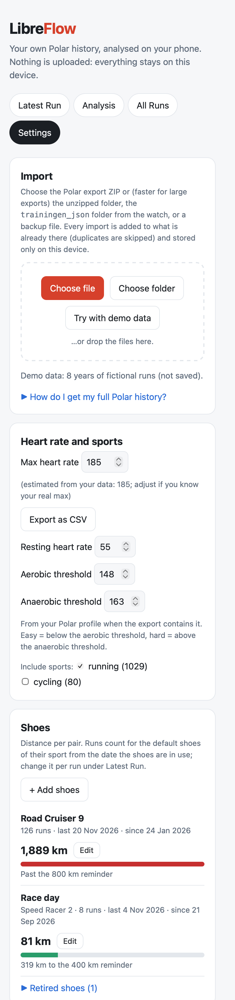
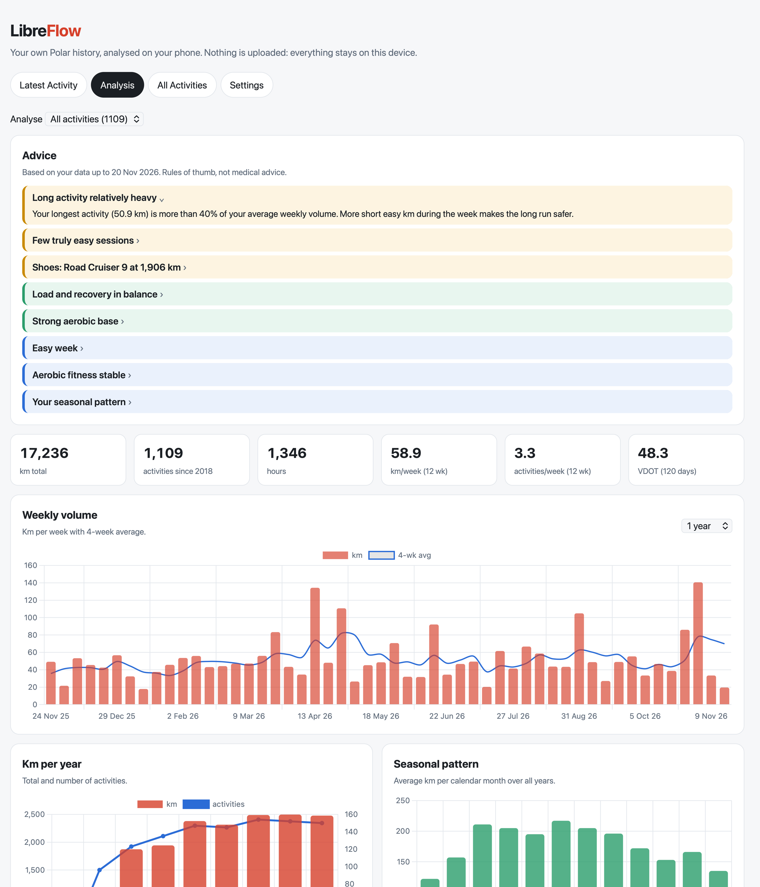

# LibreFlow

## Why: digital autonomy

A sports watch records some of the most personal data there is: your heart rate, second by second, where you live
and where you run, when you sleep, how fit you are and how that changes over the years. Today almost all of it goes
straight to a vendor's cloud. You can look at it there – on their terms, for as long as they keep the service
running, the price unchanged and the privacy policy the same.

Digital autonomy means staying in control of your own data and the tools that use it: being able to read it, keep
it, analyse it and decide who else may see it, without needing anyone's permission or servers. It protects your
privacy, it makes you independent of a company's business decisions, and it keeps years of training history
yours, even if an app or account disappears.

That is why LibreFlow keeps **all data local**:

- The watch is read **directly over Bluetooth**, read-only. No Polar Flow account or cloud is needed.
- Everything is stored **on your own device** – in your browser or in the iPhone app – and nowhere else.
- The analysis and advice run **on the device**, with transparent rules: no cloud service, no tracking, no
  external AI looking at your data.
- Nothing leaves your device unless **you** choose to: exporting a run to Strava is optional, shows a preview
  first, and *Settings › Privacy* decides whether heart rate (off by default) and the GPS route are included.
- Your data stays in **open, readable formats**, and the code is here for anyone to check.

## What it is

Private, local analysis of your Polar running data. Tested with a Polar Grit X (firmware 3.1.0).

- **Browser page** (`libreflow.html`): open it in Safari or Chrome and load your Polar Flow export.
- **iPhone app** (`ios/`): reads the watch directly over Bluetooth, shows the same analysis and can export a run
  to Strava (heart rate only if you tick it).
- **Bluetooth tool** (`polar_ble.py`): read-only download of trainings from the watch on a Mac/PC.

## Strava (optional)
Every run synced from the watch has an **Export…** button in the app. Two ways to get a run on Strava:

- **File upload – free Strava account.** *Export…* saves the run as a **GPX file** and you upload it yourself. Nothing is
  sent automatically.
- **Direct upload – paid Strava subscription.** Strava's API requires a subscription. Switch on *Settings ›
  Strava › Upload to Strava*: the button becomes **To Strava…** and uploads the run for you after the preview.

### File upload (free account)

1. Open a run synced from the watch › **Export…** › **Export…** (a GPX file with route, time, elevation and cadence; whether heart rate
   and the GPS route are included is set under *Settings › Privacy*; without GPS it is a TCX file)
   (Files, iCloud Drive or AirDrop to your Mac).
2. Upload it at **strava.com › + › Upload activity › File** (`https://www.strava.com/upload/select`). On an iPhone,
   Safari needs *Request Desktop Website* for that page; the Strava app cannot import files.

### Direct upload (paid subscription)
1. On strava.com go to `https://www.strava.com/settings/api` and create an API application with
   *Authorization Callback Domain* `localhost`.
2. In the app: *Settings › Strava* › switch on **Upload to Strava**, then under *Direct upload* enter the Client ID
   and Client Secret and tap **Connect Strava**.
3. The run button is now **To Strava…** › **Upload to Strava**.

## Screenshots
Fictional demo data. Try it yourself: open `libreflow.html#demo` (add `&view=trends`, `runs` or `settings`).

| Latest Activity | Analysis | All Activities | Settings |
|---|---|---|---|
|  |  |  |  |

On a wide screen:



## Files
- `libreflow.html` – analysis app for the browser: tabs **Latest Activity** (the newest run, older/newer),
  **Analysis** (advice, charts, predictions, records), **All Activities** (list of all activities, filter by sport) and **Settings** (import, backup, heart
  rate and thresholds, sports, shoes). Reads the Polar Flow export (ZIP or folder), `training-session*.json` files and
  backups. Data is kept in the browser's local storage only; open the file in Safari or Chrome.
- `polar_ble.py` – Bluetooth tool (Polar's PSFTP protocol). Reads files; with `--sync` it only sends Polar's
  sync start/stop notifications. Nothing on the watch is written or deleted.
- `ios/` – the iPhone app **LibreFlow** (see [ios/README.md](ios/README.md)).
- `horloge_dump/`, `horloge_data/` – raw training files downloaded from the watch (contain GPS routes: keep private).
- `trainingen_json/` – decoded watch trainings for the analysis page.
- `polar-user-data-export_…/` – Polar Flow data export (private: GPS, date of birth).

## What is proven to work
- Service `FEEE` with characteristics `FB005C51` (request/response), `FB005C52` (notifications from the watch),
  `FB005C53` (notifications to the watch).
- Pairing is required (otherwise "Insufficient Authentication"); on Windows it must happen in the same connection.
- Sync session as in the Polar BLE SDK: `INITIALIZE_SESSION (8)`, `START_SYNC (0)` … `STOP_SYNC (1, completed=true)`,
  `TERMINATE_SESSION (9)` on `FB005C53`.
- Trainings: `/U/0/<YYYYMMDD>/E/<HHMMSS>/` with `TSESS.BPB`, `00/BASE.BPB`, `00/STATS.BPB`, `00/SAMPLES.GZB`
  (1 s series), `00/ROUTE.GZB` (GPS). Decoding verified against the watch's own summary.
- Windows: reconnecting to the paired watch fails (link not encrypted, MTU 23, "Unreachable").
  macOS and iOS (CoreBluetooth): pairing, sync and reconnecting all work (20 Nov 2026).
- The watch keeps only a few complete trainings; the full history comes from the Polar Flow export.

## Using polar_ble.py on the Mac
```
python3 -m pip install bleak
python3 polar_ble.py scan
python3 polar_ble.py --sync ls "Grit X" /U/0/
```
First time: put the watch in pairing mode (Settings › General settings › Pair and sync › Pair and sync phone) and
accept the pairing request. On macOS the address is a UUID; part of the name (`"Grit X"`) works too.
Terminal needs Bluetooth permission (System Settings › Privacy & Security › Bluetooth). Run Bluetooth commands
yourself in Terminal: started from Claude, macOS stops Python because Claude has no Bluetooth permission.

### Download all trainings
Read-only and resumable: interrupted? Just start again, it continues where it stopped.
```
python3 polar_ble.py --sync all "Grit X" --max 3     # trial run: 3 trainings
python3 polar_ble.py --sync all "Grit X"             # everything since 2023 (--since YYYYMMDD) -> horloge_data/
python3 polar_ble.py export                          # -> trainingen_json/ (with 1 s series, without GPS)
```
Then open `libreflow.html` › Settings › Choose folder › `trainingen_json`.
`export --full` also includes the GPS route. The earlier Dutch names (`alles`, `exporteer`, `--vanaf`,
`--volledig`) still work.
