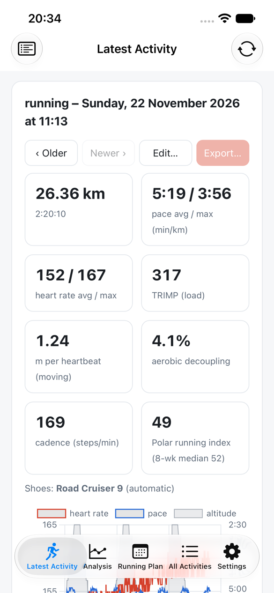
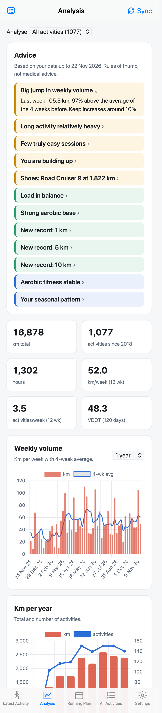
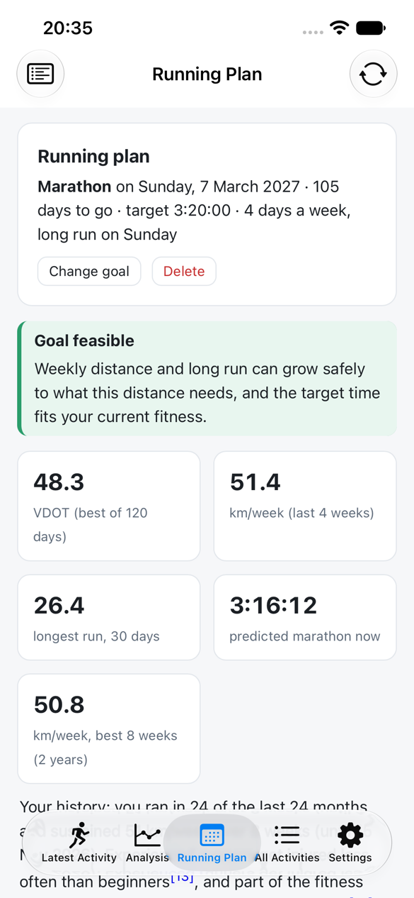
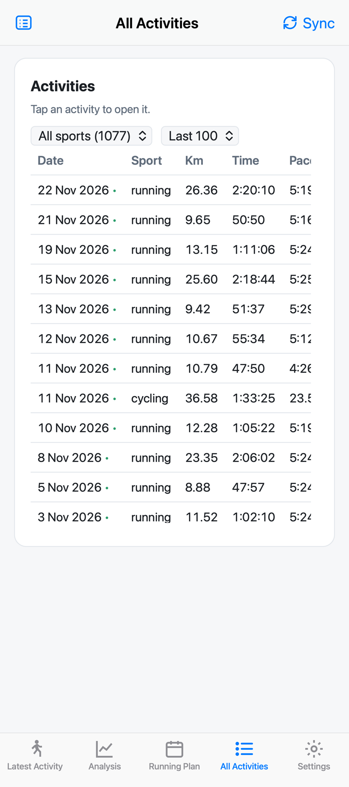
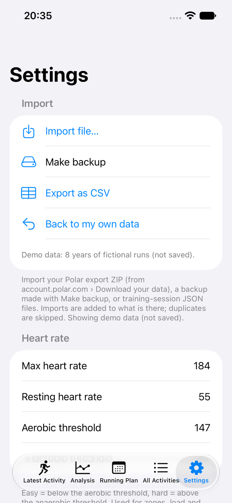

# LibreFlow

An iPhone app that reads your Polar watch directly over Bluetooth, analyses your trainings on the phone and – only
when you choose to – exports a training or sends it to Strava. No Polar Flow, no account, no cloud, no external AI.
Tested with a Polar Grit X (firmware 3.1.0).

| Latest Activity | Analysis | Running Plan | All Activities | Settings |
|---|---|---|---|---|
|  |  |  |  |  |

*Fictional demo data.* There is also a [browser version](web/README.md) of the same analysis for a Mac or PC.

## Why: digital autonomy

A sports watch records some of the most personal data there is: your heart rate, second by second, where you live
and where you run, when you sleep, how fit you are and how that changes over the years. Today almost all of it goes
straight to a vendor's cloud. You can look at it there – on their terms, for as long as they keep the service
running, the price unchanged and the privacy policy the same.

Digital autonomy means staying in control of your own data and the tools that use it: being able to read it, keep
it, analyse it and decide who else may see it, without needing anyone's permission or servers. It protects your
privacy, it makes you independent of a company's business decisions, and it keeps years of training history
yours, even if an app or account disappears.

That is why LibreFlow keeps **all data local**:

- The watch is read **directly over Bluetooth**, read-only. No Polar Flow account or cloud is needed.
- Everything is stored **on your own device** and nowhere else.
- Routes can be shown on an OpenStreetMap map (map tiles for the area you view are loaded from openstreetmap.org);
  switch the map off and the route is drawn without loading anything.
- The analysis and advice run **on the device**, with transparent rules: no cloud service, no tracking, no
  external AI looking at your data.
- Nothing leaves your device unless **you** choose to: exporting a run to Strava is optional, shows a preview
  first, and *Settings › Privacy* decides whether heart rate (off by default) and the GPS route are included.
- Your data stays in **open, readable formats**, and the code is here for anyone to check.

## What is in the app
- **Latest Activity**: your newest activity (older/newer), with pace or speed, heart rate, running index, a chart,
  the route on a map, kilometre splits and time per zone. **Edit…** changes the sport or shoes, or deletes it.
- **Analysis**: advice at the top, key figures, charts, deep analysis, predictions and records. Choose *All
  activities* or one sport at the top; the app remembers your choice.
- **Running Plan**: an adaptive training plan for a goal race (5 km, 10 km, 10 miles, half, marathon or any distance you
  enter, on a date, optionally with a target time). It is rebuilt from what you actually ran after every activity: weekly distance grows from your real
  volume (experienced runners may rebuild faster towards the volume they sustained in the last 2 years), paces follow your current fitness, missed sessions are not made up, load spikes and fatigue signals turn
  hard sessions into easy ones. It also works without any history: enter your current km/week, longest recent run and a recent race time
  (each only counts for the period it describes), or start from scratch with easy running only. When the goal is
  no longer feasible you get a message. Every session explains why it
  looks the way it does, with numbered references to the research it is based on (Daniels, Seiler, Bosquet,
  Frandsen and others). Rule-based and on the device, like the rest of the analysis.
- **All Activities**: every activity, with a filter by sport.
- **Sync** (top right): reads new trainings from the watch – read-only, plus Polar's sync notifications. The
  button next to it shows the **sync log**.
- **Export…** on every activity synced from the watch: a preview with map, then a GPX file (TCX for runs without
  GPS). With *Settings › Strava* on it becomes **To Strava…** (direct upload, paid Strava subscription).
- **Settings**: import (Polar export ZIP, backup, JSON), make backup (a ZIP with the summary and the raw data:
  per-second series and GPS route of every activity), CSV, demo data, heart rate and thresholds, shoes, privacy,
  Strava, forget watch, delete data.
- **Settings › Training zones**: five heart-rate and five pace zones, automatic (from your heart-rate settings and
  current fitness) or set by hand; the running plan shows which zone each session falls in. *Send zones to watch…*
  reads the running profile from the watch, shows the zones now and after the change, and only after you confirm
  writes nothing but the zone limits (with a backup and *Restore original zones…*).
- **Running Plan › Send to watch…**: the next 7 days of the plan as favorites on the watch, with distance goals,
  heart-rate zones for easy running and your pace zones for the fast parts. Earlier LibreFlow favorites are replaced;
  favorites from Polar Flow are never changed.
- **Settings › Privacy**: include heart rate (**off** by default) and the GPS route (on) in exports and uploads;
  *Show map* (on): routes on OpenStreetMap – the only internet access the analysis has; off = route drawn without
  a map.

## Install

### With SideStore (no Mac needed to refresh)
1. Download `LibreFlow.ipa` from the **Releases** page (or build it yourself: `zsh tools/make_ipa.sh` →
   `build/LibreFlow.ipa`). It is unsigned (SideStore signs it with your Apple ID), uses the neutral bundle id
   `app.libreflow` and is stripped of debug symbols, so it contains nothing of the person who built it.
2. Put the file on the iPhone (AirDrop or iCloud Drive).
3. SideStore › **My Apps** › **+** › choose `LibreFlow.ipa` (SideStore's VPN on).
4. Every 7 days: SideStore › My Apps › **Refresh All**.

SideStore changes the bundle identifier, so this is a separate app from one installed with Xcode, with its own
(empty) data: make a backup in the old app first, or import the Polar export ZIP again.

### With Xcode (free Apple ID is enough)
1. Install **Xcode** from the Mac App Store and open it once (install the iOS platform when asked).
2. Xcode › Settings › Accounts › **+** › Apple ID: sign in with your normal Apple ID. A *Personal Team* appears.
3. Copy `Local.xcconfig.example` to `Local.xcconfig` and fill in your Team ID (Xcode › Settings › Accounts › your
   Apple ID) and a unique bundle identifier. This file stays out of git.
4. Install XcodeGen (`brew install xcodegen`), run `xcodegen generate` in this folder and open
   `LibreFlow.xcodeproj` (generated, not in git).
5. Connect the iPhone with a cable, unlock it and tap *Trust This Computer*.
6. iPhone: Settings › Privacy & Security › **Developer Mode** on (the iPhone restarts).
7. Choose your iPhone as destination in Xcode and click **▶︎ (Run)**.
8. First time: iPhone › Settings › General › VPN & Device Management › your Apple ID › **Trust**. Then ▶︎ again.

Command line instead of Xcode's ▶︎:
```
export DEVELOPER_DIR=/Applications/Xcode.app/Contents/Developer
xcodebuild -project LibreFlow.xcodeproj -scheme LibreFlow -destination 'generic/platform=iOS' -derivedDataPath build -allowProvisioningUpdates build
xcrun devicectl device install app --device <iPhone UDID> build/Build/Products/Debug-iphoneos/LibreFlow.app
```

**Free account:** the app works for 7 days. Then connect the iPhone and install again. Your data is kept as long
as you do not delete the app. At most 3 self-installed apps at a time.

## First use
1. **Watch**: tap **Sync**. If the watch is already paired with the iPhone you do not need to do anything on the
   watch (the watch's own sync button is meant for Polar Flow and makes the watch wait for Polar Flow). Never
   paired? Put the watch in pairing mode (Settings › General settings › Pair and sync › Pair and sync phone) and
   accept the pairing request.
2. **History**: the watch keeps only a few complete trainings. For your full history, download your data from
   Polar (account.polar.com › Download your data, ~75 MB) and import the ZIP via *Settings › Import file…*.
   A backup made in the browser version (*Make backup*) works too.

## Strava (optional)
Two ways to get a run on Strava:

- **File upload – free Strava account.** *Export…* saves the run as a **GPX file** (route, time, elevation and
  cadence; heart rate and the GPS route as set under *Settings › Privacy*; without GPS it is a TCX file). Save it
  to Files, iCloud Drive or AirDrop it to your Mac, and upload it at **strava.com › + › Upload activity › File**
  (`https://www.strava.com/upload/select`). On an iPhone, Safari needs *Request Desktop Website* for that page;
  the Strava app cannot import files.
- **Direct upload – paid Strava subscription.** Strava's API requires a subscription.
  1. On strava.com go to `https://www.strava.com/settings/api` and create an API application with
     *Authorization Callback Domain* `localhost`.
  2. In the app: *Settings › Strava* › switch on **Upload to Strava**, then under *Direct upload* enter the Client
     ID and Client Secret and tap **Connect Strava**.
  3. The activity button is now **To Strava…** › **Upload to Strava**.

## Folders
- `LibreFlow/` – the app (SwiftUI): `BLE/` (Polar's PSFTP protocol over Bluetooth), `Training/` (decoder and
  storage), `Strava/` (GPX/TCX and upload), `Views/`, `Web/` (the analysis page and its local libraries).
- `project.yml` – XcodeGen project; `Local.xcconfig.example` – template for your signing settings.
- `tools/` – `make_app_page.py` (builds `LibreFlow/Web/index.html` from `web/libreflow.html` at every build),
  `make_ipa.sh` (unsigned IPA for SideStore), `make_icon.py` (app icon).
- `web/` – the [browser version](web/README.md) and the Bluetooth tool for a Mac or PC.

## After changes
- Changed the analysis? Edit `web/libreflow.html` (the single source) and build again; the app version is
  generated automatically.
- Changed `project.yml`? Run `xcodegen generate` first.
- App icon: drawn by `tools/make_icon.py` into `LibreFlow/Assets.xcassets/AppIcon.appiconset/AppIcon.png`.

## Troubleshooting
- The sync log is also written to `sync-log.txt` in the app's folder (Files app, or
  `xcrun devicectl device copy from --domain-type appDataContainer --domain-identifier <bundle id> --source Documents/sync-log.txt`).

## How the watch is read
- Service `FEEE` with characteristics `FB005C51` (request/response), `FB005C52` (notifications from the watch),
  `FB005C53` (notifications to the watch).
- Pairing is required (otherwise "Insufficient Authentication").
- Sync session as in the Polar BLE SDK: `INITIALIZE_SESSION (8)`, `START_SYNC (0)` … `STOP_SYNC (1, completed=true)`,
  `TERMINATE_SESSION (9)` on `FB005C53`. Nothing on the watch is written or deleted.
- Trainings: `/U/0/<YYYYMMDD>/E/<HHMMSS>/` with `TSESS.BPB`, `00/BASE.BPB`, `00/STATS.BPB`, `00/SAMPLES.GZB`
  (1 s series), `00/ROUTE.GZB` (GPS). Decoding verified against the watch's own summary.
- Sources: [Polar BLE SDK](https://github.com/polarofficial/polar-ble-sdk) and the file formats in
  [cmaion/polar](https://github.com/cmaion/polar).
