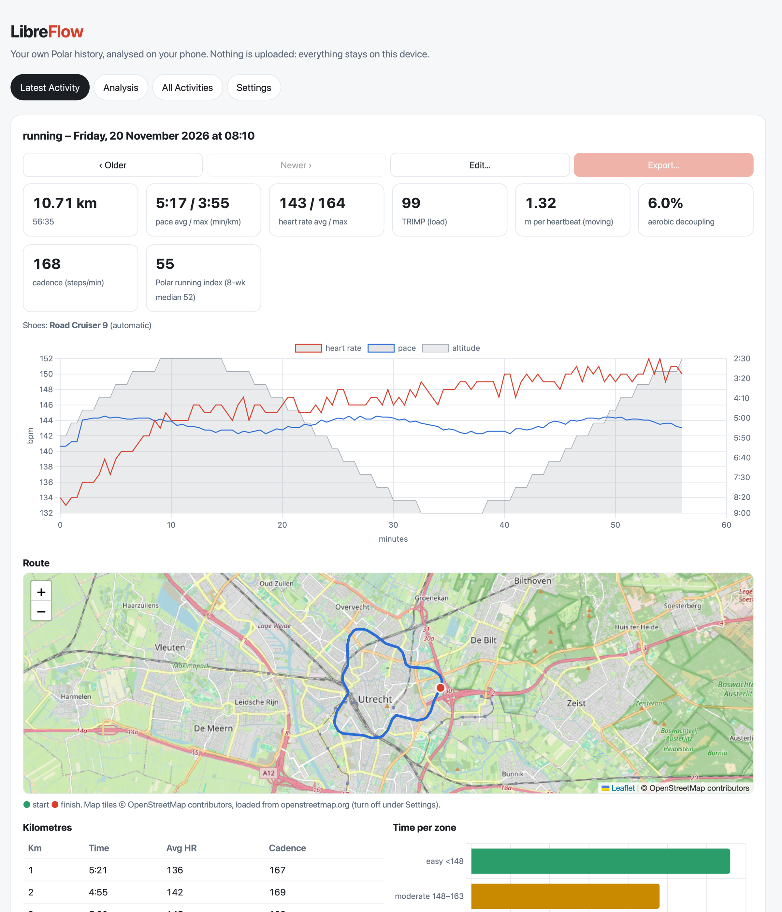
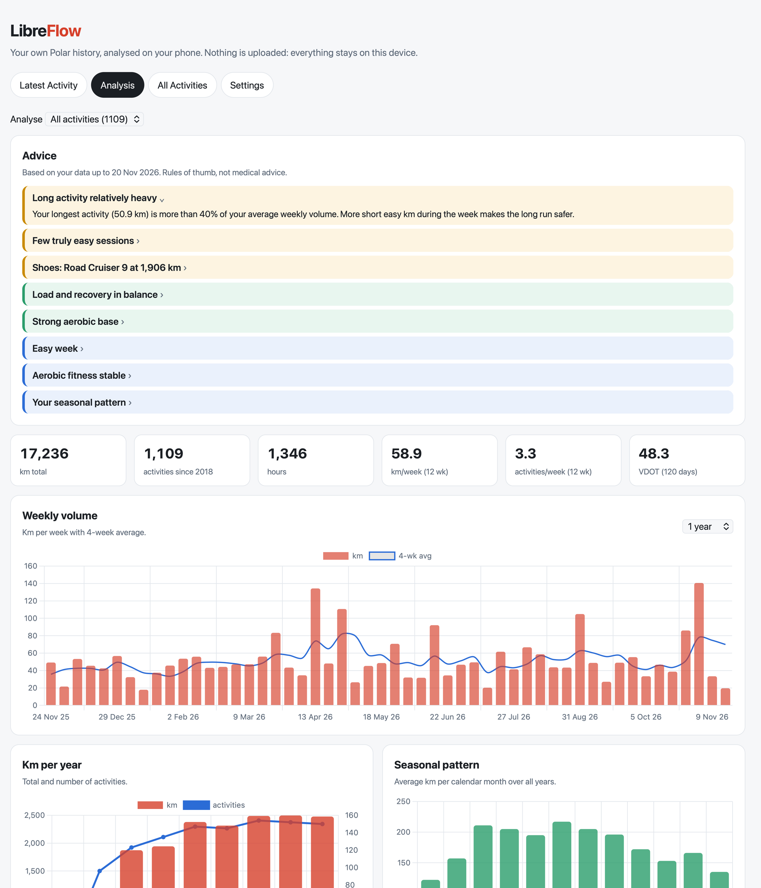
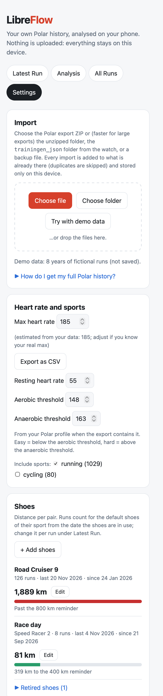

# LibreFlow – browser version and Bluetooth tool

The same analysis as the [iPhone app](../README.md), as a single page for a Mac or PC, plus a command-line tool
that reads trainings from the watch over Bluetooth.







*Fictional demo data.* Try it yourself: open `libreflow.html#demo` (add `&view=trends`, `plan`, `runs` or `settings`).

## libreflow.html
Open it in Safari or Chrome (double-click it in the Finder) and load your Polar Flow export.

- Tabs **Latest Activity** (newest activity, older/newer, route on a map), **Analysis** (advice, charts,
  predictions, records; one sport or all), **Running Plan** (adaptive training plan for a goal race, with the reasoning and
  sources per session), **All Activities** (list, filter by sport) and **Settings** (import, backup, heart rate and
  thresholds, map, shoes).
- Reads the Polar Flow export (ZIP or unzipped folder), `training-session*.json` files, the `trainingen_json`
  folder from `polar_ble.py` and backups (ZIP, also from the app).
- Data is kept only in the browser's local storage (summary) and IndexedDB (raw per-second data and routes).
  *Make backup* saves everything as a ZIP that the iPhone app can import too.
- Loads Chart.js, JSZip and Leaflet from cdnjs.cloudflare.com, and map tiles from openstreetmap.org (switch the map
  off under *Settings* to draw routes without loading tiles). Your data itself is never sent anywhere.
- This page is the single source of the analysis: the app's version is generated from it
  (`tools/make_app_page.py`).

## polar_ble.py
Bluetooth tool (Polar's PSFTP protocol). Reads files; with `--sync` it only sends Polar's sync start/stop
notifications. Reading writes or deletes nothing on the watch; only the write commands below (which ask you to
type WRITE or REMOVE) do.

```
python3 -m pip install bleak
python3 polar_ble.py scan
python3 polar_ble.py --sync ls "Grit X" /U/0/
```
First time: put the watch in pairing mode (Settings › General settings › Pair and sync › Pair and sync phone) and
accept the pairing request. On macOS the address is a UUID; part of the name (`"Grit X"`) works too.
Terminal needs Bluetooth permission (System Settings › Privacy & Security › Bluetooth).

### Download all trainings
Read-only and resumable: interrupted? Just start again, it continues where it stopped.
```
python3 polar_ble.py --sync all "Grit X" --max 3     # trial run: 3 trainings
python3 polar_ble.py --sync all "Grit X"             # everything since 2023 (--since YYYYMMDD) -> horloge_data/
python3 polar_ble.py export                          # -> trainingen_json/ (with 1 s series, without GPS)
```
Then open `libreflow.html` › Settings › Choose folder › `trainingen_json`.
`export --full` also includes the GPS route. The earlier Dutch names (`alles`, `exporteer`, `--vanaf`,
`--volledig`) still work.

The folders it creates (`horloge_data/`, `horloge_dump/`, `trainingen_json/`) contain your trainings including
GPS routes: keep them private (they are in `.gitignore`).

### Routes
`route-build` turns a GPX file into the watch's route files (offline); `route-put` writes them as a new route plus
its favorite after you type WRITE; `route-rm` lists the routes and removes a LibreFlow route (type REMOVE), keeping
the folders without gaps (`--fix-gaps` repairs a gap). The app does this at Sync for the routes you check under
Settings › Watch › Routes.
```
python3 polar_ble.py route-build route.gpx route_out
python3 polar_ble.py --sync route-put "Grit X" route_out
```

### Platforms
- macOS (CoreBluetooth): pairing, sync and reconnecting all work.
- Windows: pairing must happen in the same connection (`--pair`); reconnecting to the paired watch fails (link
  not encrypted, MTU 23, "Unreachable").
